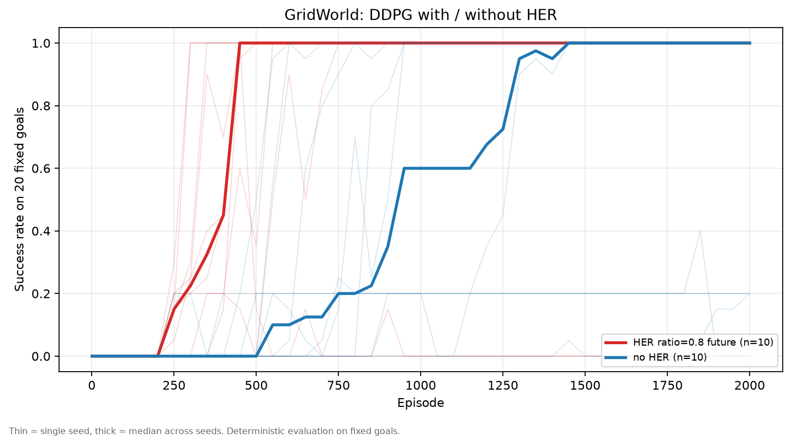

# 12_HER / GridWorld

二维目标导向任务上的 HER（Hindsight Experience Replay）实现与消融。

参考：《动手学强化学习》第 19 章 · <https://hrl.boyuai.com/chapter/3/目标导向的强化学习>

> 2026-10-28：pipeline 已按下面的结构实现；`practice.py` 保留为教程原版参考。

**和教程的差别**（这些差别是有意的，不是跑偏）：

| 项 | 教程 | 这里 | 为什么 |
| --- | --- | --- | --- |
| `done` | 一个 bool，到达或超时都为 True | 拆成 `terminated` / `truncated` | 换目标时只有 `terminated` 该被重算，超时和目标无关。教程混在一起，直接改写容易埋 bug，`../../experiments/seed_experiments/five_algorithms/经验总结.md` §4 已经栽过一次同类问题 |
| 随机数 | 全局 `np.random.seed` | 每个 env 一个 `np.random.default_rng(seed)` | 多 seed 并行跑时全局状态会互相污染 |
| 评估 | 看训练回报 | 固定 20 个目标 + **成功率** | 稀疏奖励下回报只有 -50（全程失败）/ -5 左右（到达）两档，看不出差别；具身方向面试问的也是成功率 |
| 训练脚本 | notebook 里两段复制粘贴 | 一个 `main.py` + 开关 | 消融只改 `config.py` |

## 代码阅读顺序（教学用）

代码里的注释按"第一次读也能跟上"的密度写，建议按依赖顺序读：

1. `environment.py` —— 先搞清 s、a、r、φ、terminated/truncated 分别是什么；
2. `rl_utils.py` —— 本周核心。`Trajectory` 的存储布局 → `_choose_goal` 的三种策略 → `sample` 的五步流程；
3. `trainer.py` —— 看一条轨迹如何被收集、入 buffer、触发更新、被评估；
4. `agents.py` —— DDPG 的两次反向传播和一次软更新（公式写在模块 docstring 里）；
5. `networks.py` —— 只有形状和激活，确认"网络不知道哪两维是目标"；
6. `config.py` / `main.py` —— 最后看装配和超参，再跑起来对照曲线。

`practice.py` 是教程原版，保持原样作为对照；它和本实现逐段差异见 `pipeline.md`。

## 文件结构

```text
12_HER/GridWorld/
  config.py          超参 + HER 开关 + 评估设置
  environment.py     GridWorldEnv + compute_reward + make_environment
  networks.py        Actor / Critic
  agents.py          DDPG（修了动作 clip 和 target no_grad）
  rl_utils.py        Trajectory / ReplayBufferTrajectory（HER 核心）
  trainer.py         按轨迹训练 + 固定目标成功率评估
  visualization.py   回报曲线 + 成功率曲线
  main.py            入口（默认配置，画图）
  run.cmd            Windows 一键运行 main.py
  practice.py        教程原版，保留作对照
  pipeline.md        practice.py 的逐段拆解与 DDPG 差异说明
  requirements.txt   numpy / torch / tqdm / matplotlib
  README.md          本文件
```

实验脚本、结果和经验总结在仓库级目录：

- 主对比：`../../experiments/seed_experiments/her_main/`
- ratio 消融：`../../experiments/ablations/her_ratio/`
- 经验总结：`../经验总结.md`

## 实现说明（已按此拆分）

`practice.py` 保留为教程原版；以下文件是按 `09_DDPG` 的拆法实现的 pipeline。
**HER 的核心在 rl_utils.py 里**，其余是把 DDPG 搬过来。

### 1. `rl_utils.py` —— 本周唯一的新东西

```python
class Trajectory:
    """一条完整轨迹。states 比 actions 多一个（含初始状态和终态）。"""
    # states: list, actions/rewards/terminated 各 length 个
    # length 属性 = len(actions)

class ReplayBufferTrajectory:
    """存整条轨迹，采样时做 HER 重标注。"""
    # add_trajectory(traj) / size() / sample(batch_size)
```

`sample()` 必须做到：

1. 随机挑一条轨迹，随机挑一个时刻 `t`
2. 取 `s_t, a_t, r_t, s_{t+1}, terminated_t`
3. 以 `HER_RATIO` 的概率重标注：
   - 按 `GOAL_STRATEGY` 选 `g'`
   - `r' = env.compute_reward(φ(s_{t+1}), g')`
   - `terminated' = env.is_success(φ(s_{t+1}), g')`
   - `s_t` 和 `s_{t+1}` 的目标那两维换成 `g'`
4. 注意：`truncated` **不参与重标注**，它只影响采样时刻的上界

### 2. `networks.py`

和 `09_DDPG` 一样，只是 `state_dim=4`。actor 输出 `tanh(x) * ACTION_BOUND`。

### 3. `agents.py`

DDPG，和 `09_DDPG/Pendulum/agents.py` 几乎一致。`take_action` 加高斯噪声。

### 4. `trainer.py`

和 DDPG 的 off-policy 循环不同：**按轨迹存，不按 transition 存**。

```text
for episode:
    state = env.reset(seed=seed+episode)
    traj = Trajectory(state)
    while not done:
        action = agent.take_action(state)
        next_state, reward, terminated, truncated, _ = env.step(action)
        traj.store_step(...)
    replay_buffer.add_trajectory(traj)
    if replay_buffer.size() >= MINIMAL_EPISODES:
        for _ in range(N_TRAIN):
            agent.update(replay_buffer.sample(BATCH_SIZE))
    if episode % EVAL_INTERVAL == 0:
        记录成功率
```

### 5. `main.py`

`set_seed` → 建 env / agent / buffer → 训练 → 打印最终成功率 → 画图。

## 四个必须自己想清楚的点

| # | 问题 | 提示 |
| --- | --- | --- |
| 1 | buffer 为什么必须存**整条轨迹** | `future` 要取"同一条轨迹里 t 之后"的状态，按 transition 存就丢了时序 |
| 2 | 重标注为什么放在**采样时**做，不是存储时 | 同一条数据每次被采到都可能换成不同目标，等于把样本量放大 |
| 3 | 新奖励为什么用 `s_{t+1}` 算 | 奖励描述的是"执行 `a_t` 之后有没有到达"，用 `s_t` 是常见 bug |
| 4 | 重标注后 `done` 要不要改 | 要。`terminated` 必须按新目标重算，`truncated` 不动 |

## 预期结果

教程自带的日志（先用来校验你的实现，跑出来对不上先查上面第 3、4 点）：

| | 开始下降 | 收敛 | 单回合耗时 |
| --- | --- | --- | --- |
| DDPG + HER | 约 200 回合 | **约 400 回合** | 0.39 s |
| DDPG 无 HER | 约 1500 回合 | **约 1800 回合** | 0.21 s |

**两种都能学会**，差别是快 4–5 倍。如果无 HER 那组也收敛了，不是跑错了。

> 上面是教程的数字，用于校验实现。本仓库实测见下一节：HER 仍然约 400 回合收敛，
> 但无 HER 基线约 770 回合，所以差距约为 **2 倍**，不是 4–5 倍。

## 实测结果（10 seeds）

| 设置 | 首次成功回合 | 收敛回合（回报） | 最终成功率均值 | ≥0.9 seeds |
| --- | ---: | ---: | ---: | ---: |
| HER `ratio=0.8 future` | **263 [237, 266]** | **408 [317, 426]** | **0.80** | **8/10** |
| 无 HER | 550 [404, 712] | 769 [608, 914] | 0.66 | 6/10 |



- HER 把首次成功回合和收敛回合都缩短到约一半；最终成功率均值 0.80 vs 0.66。
- 但 HER 有 2/10 个 seed 完全崩溃（seed 5 没学会，seed 8 学会后崩），所以 HER 不是
  稳定性保证。失败形态、debug 记录和与教程差异的解释见 [`经验总结.md`](../经验总结.md)。
- n=10，不做显著性检验；中位数会掩盖失败，报告时要同时给“≥0.9 seeds”。

## 消融计划与状态

1. ✅ `USE_HER` True / False 主对比（10 seeds，见上）
2. ⬜ `HER_RATIO` ∈ {0.2, 0.5, 0.8, 1.0}（每档 5 seeds）
3. ⬜ `GOAL_STRATEGY` ∈ {future, final, episode}（每档 5 seeds）
4. ⬜ 换 agent：SAC + HER / TD3 + HER（验证 HER 与算法无关，并改善 DDPG 崩溃）

指标统一用**成功率**，不用回报。

## 运行

```powershell
cd "C:/Users/PC/Desktop/具身智能实习/hands-on-reinforcement-learning/12_HER/GridWorld"
../../.venv/Scripts/python.exe main.py
```

消融只改 `config.py`：`USE_HER = False`、`HER_RATIO`、`GOAL_STRATEGY`。
