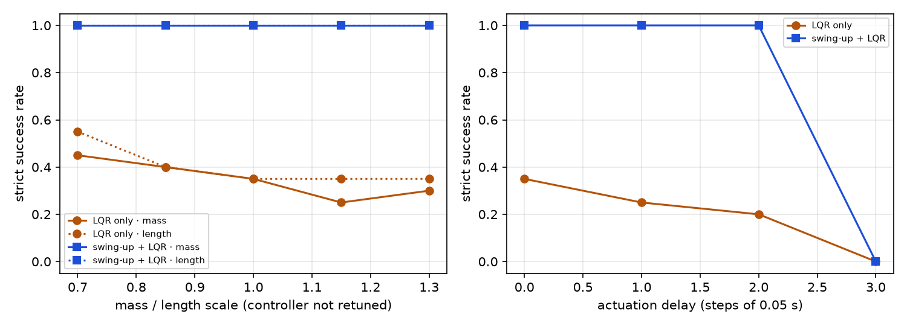

# 14_Control/Pendulum：有模型的经典控制 vs 无模型的 RL



**一句话**：在 `experiments` 已有的 Pendulum-v1 评估协议上（20 个固定起点、确定性评估），
"能量摆起 + LQR" 名义条件 20/20，和被控对象质量 / 长度在 ±30% 内偏移时仍是 20/20；
执行延迟到 3 步（0.15 s）时直接崩到 0/20。LQR 单独只有 7/20，且随扰动和延迟单调退化。

| 控制器 | 严格成功（20 个起点） | 平均回报 | 中位数回报 | 平均摆起时间 |
| --- | ---: | ---: | ---: | ---: |
| LQR 单独 | 7/20 | -804.8 | -965.0 | 0.86 s（仅成功的 7 个） |
| 能量摆起 + LQR | **20/20** | -128.5 | -126.7 | 1.60 s |
| SAC（10 seeds × 20 回合，experiments 已有结果） | 不可得（见下） | -121.7 | -121.2（逐 seed 均值的中位数） | — |

为什么做这个：RL 那一侧的评估协议是现成的，缺的是一条"有模型"的对照线。
同一条起跑线上放一个需要精确模型的控制器，才能回答"RL 到底贵在哪、赢在哪"——
不是名义分数，而是需不需要模型、需要多少样本、对模型误差和延迟有多敏感。

---

## 怎么跑

在仓库根目录，用仓库的 `.venv`：

```bash
# 1. 线性化与 LQR：核对 A、B、K、闭环极点
python -I 14_Control/Pendulum/lqr.py

# 2. 在调参集（seed 20000–20019）上网格搜索切换参数，约 5 s
python -I 14_Control/Pendulum/tune.py

# 3. 在评估集（seed 10000–10019）上出最终数字，可并排显示 SAC
python -I 14_Control/Pendulum/evaluate.py --controller both --compare-sac

# 4. 参数扰动与执行延迟，加 --plot 出图
python -I 14_Control/Pendulum/robustness.py --plot
```

`sys.path` 由脚本自己处理（`python -I` 不会把脚本目录加进去），所以不需要 `cd` 到目录里。

## 文件

| 文件 | 内容 |
| --- | --- |
| `model.py` | 被控对象动力学、解析线性化、ZOH 离散化、LQR 求解；`verify_against_gym()` 逐步对照 gymnasium 的 Pendulum-v1 |
| `sim.py` | 回合循环、延迟注入、指标定义（严格成功 / 回报成功 / 摆起时间），三个入口共用 |
| `lqr.py` | 打印 A、B、Ad、Bd、K、闭环极点，并扫描 Q/R 对 K 的影响 |
| `swingup.py` | 能量摆起控制器 + 带滞回的 LQR 切换 |
| `tune.py` | 在调参 seed 上网格搜索 k / theta_enter / omega_enter |
| `evaluate.py` | 在评估 seed 上跑控制器，输出逐回合表、汇总和 SAC 对照 |
| `robustness.py` | 质量 / 长度缩放 + 执行延迟的扫描，写 CSV、可选出图 |

结果写到仓库根目录的 `results/`：`control_tuning.json`、`control_eval.json`、
`control_robustness.csv`、`control_robustness.png`。

## 口径（写在数字前面）

- **固定起点**：与 `experiments/seed_experiments/five_algorithms` 完全相同，
  从 `reset(seed=10000+i)` 取初始状态，20 个起点所有控制器共用。
- **严格成功**：最后 2.5 s（50 步）每一步 `|angle_normalize(theta)| < 0.15 rad`。
  这是本项目自己的定义，不是 gym 或论文的标准。
- **回报成功**：回合回报 ≥ -200。`experiments` 的 -200 是对 20 个起点的**平均回报**说的，
  这里借来做逐回合粗判据，两套都报、不混用。
- **摆起时间**：第一个"此后每一步都 |theta| < 0.15"的时刻。
- **调参集与评估集分开**：切换参数在 seed 20000–20019 上选，评估集 seed 10000–10019
  只用来出最终数字。规划期试算曾在评估起点上调参，正式版改掉了。

两个口径会给出不一致的成功率，原因是真实的：摆起慢的回合（2.4–3.2 s）
在摆起阶段累积了较多角度代价，回报落在 -230 到 -260 之间，于是"严格成功 20/20、
回报成功 14/20"。**-200 这个阈值是给"起点就在直立附近"的任务设计的，
对需要摆起的任务不公平**；两条都报，是因为仓库里其他实验用的是 -200。

## 结果解读

1. **LQR 单独只能救 7/20**：线性化只在直立点附近有效，起点离直立越远，非线性越强，
   线性控制器的吸引域有限。7/20 与规划期试算一致。
2. **摆起 + LQR 名义 20/20**：摆起负责把"离直立很远"变成"进入吸引域"，
   之后交回 LQR；平均 1.6 s 摆起来。
3. **参数扰动 ±30% 下摆起 + LQR 仍是 20/20**：这个结果**不支持**"经典控制一定更怕模型误差"
   的直觉。原因是能量摆起本身是反馈律（`dE/dt = u * theta_dot`，对 m、l 的依赖主要是
   能量零点），被控对象参数变了，它仍然会把能量推到目标附近；LQR 只负责最后一小段。
   换句话说，**怕模型误差的是线性化那一段，不是摆起那一段**。
4. **3 步延迟（0.15 s）全崩**：延迟在频域是纯相位滞后，而这个系统本身有不稳定极点，
   相位裕度本来就小。LQR 单独随延迟缓慢退化（7 → 5 → 4 → 0）；
   摆起 + LQR 在 1–2 步内几乎无损（摆起是慢过程，不怕 50–100 ms），第 3 步直接 0/20。
5. **和 SAC 比什么**：名义回报 SAC 略好（中位数 -121.2 vs -126.7），但它需要约 40k 步
   与环境交互；摆起 + LQR 不需要任何训练，代价是要有 m、l 和动力学方程。
   SAC 的严格成功率现有结果算不出来（JSON 只存了回报），所以表里留空，不猜。

## 边界（面试时主动说）

- 这是**软件在环之前**的纯 Python 版本，不是 sim2real。参数扰动是 sim2real gap 的简化代理，
  不是硬件在环（HIL），更不是上板。
- Pendulum 是 LQR 的舒适区：低维、动力学精确已知、单输入。结论只在这个任务上成立，
  不外推到机械臂。
- 只有 20 个评估起点、单个被控对象；差距在 1–2 分以内不做排名，也不做显著性检验
  （沿用 `experiments` 的口径）。
- 调参网格的最优解落在边界（k=0.8、theta_enter=0.9），说明在这个指标下平台很平：
  100 组参数里 64 组都是 20/20。抽查 k 到 2.0、theta_enter 到 1.1 也没有更好的解，
  所以没有继续扩网格，而是按"成功率 → 回报"选了一组。这是选择规则，不是最优性证明。

## 与规划期试算的差异（如实记录）

| 项 | 规划期试算 | 本次复算 | 说明 |
| --- | --- | --- | --- |
| K（Q=diag(1,0.1), R=0.001） | ≈ [19.7, 5.26] | [19.67, 5.73] | K_theta 一致，K_omega 高约 9%；试算的离散化细节没有留档，本次从 ZOH 重新推 |
| LQR 单独成功率 | 7/20 | 7/20 | 一致 |
| 摆起 + LQR 成功率 | 20/20 | 20/20 | 一致 |
| 摆起 + LQR 平均回报 | ≈ -122 | -128.5 | 切换参数不同（试算在评估起点上调过参） |
| LQR 单独，延迟 0/1/2/3 步 | 7/5/4/0 | 7/5/4/0 | 一致 |

## 待办（W6，不在这一版里）

- 离散化对比：Euler / ZOH / Tustin 三种方法的闭环极点，采样周期扫描，画出失稳边界；
- 状态估计：只给角度，速度用差分 + 一阶低通，量出滤波滞后的代价；
- C 实现：`control_step()`，float 与 Q15 定点两版，含限幅和切换滞回；
- 软件在环（SIL）：Python 被控对象 ↔ C 控制器（`ctypes`），注入延迟和编码器量化，
  与 Python 版逐步数值对照。

`robustness.py` 已经能注入执行延迟，SIL 会在同一个 `sim.py` 接口上复用。
