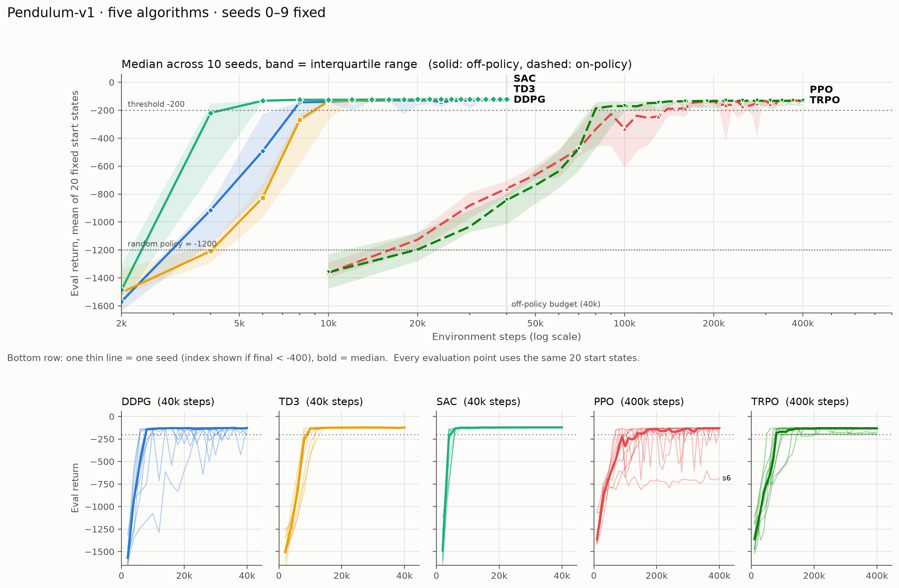

# 强化学习：算法实现与可复现实验

从表格型控制到连续动作策略，使用 Python、Gymnasium 和 PyTorch 实现并分析强化学习算法。项目以《动手学强化学习》等公开资料为起点，覆盖算法组件拆分、固定种子评估、失败案例诊断、消融实验，以及经典控制与模仿学习对照。

## 项目重点

- **算法实现**：Q-learning / SARSA、DQN 系列、REINFORCE、Actor-Critic、TRPO、PPO、DDPG、TD3、SAC 和 HER。每个章节保留独立入口，便于阅读更新公式与数据流。
- **实验设计**：Pendulum 五算法对比使用 10 个训练种子和相同的 20 个评估初始状态，记录确定性评估、训练预算和逐种子结果。
- **问题诊断**：记录 PPO/TRPO 的批量大小、时间截断与 GAE 边界问题；通过 HER 比例/采样策略消融和 SAC 超参扫描，区分性能变化与实现问题。
- **对照分析**：HalfCheetah SAC 的较大规模实验、Pendulum 经典控制的参数扰动/执行延迟测试，以及 BC 在反馈控制和多模态任务上的表现。

这些是教学实现与实验复现；结果范围受环境、预算和种子数量限制。ACT 与 Diffusion Policy 目前只有算法笔记，未实现训练系统。来源和参考实现见文末。

## 建议阅读路径

| 阅读目的 | 推荐入口 |
| --- | --- |
| 快速了解实验质量 | [五算法结果](experiments/seed_experiments/five_algorithms/results/tables.md)与[分析](experiments/seed_experiments/five_algorithms/经验总结.md) |
| 查看连续控制实现 | [SAC](11_SAC/README.md)：策略采样 → 双 Q 目标 → actor 更新 → 温度调节 |
| 查看数据层改造 | [DDPG + HER](12_HER/GridWorld/README.md)：轨迹回放、目标重标记、成功率评估 |
| 查看更大任务与消融 | [HalfCheetah SAC](experiments/seed_experiments/halfcheetah_sac/README.md)与[超参实验](experiments/ablations/sac_hparams/README.md) |
| 理解工程结构与验证方式 | [开发说明](docs/development.md) |
| 顺序学习算法 | [算法路线](算法路线.md)与下方章节索引 |

## 实验结果与边界

以下为仓库中保留的历史实验数据，修改文档时未重跑完整训练。所有表格均可追溯到对应目录的原始 JSON 和汇总脚本。

### Pendulum：五算法对比

10 个训练种子；每次评估使用相同的 20 个起始状态和确定性策略。off-policy 预算为 40k 环境步，on-policy 为 400k，**两组训练预算不同**。首次达标指平均评估回报 ≥ −200，具体统计见[原始汇总表](experiments/seed_experiments/five_algorithms/results/tables.md)。



| 算法 | 训练预算 | 最终评估回报中位数 | 最终达标种子 | 首次达标步数中位数 |
| --- | ---: | ---: | ---: | ---: |
| SAC | 40k | −121.2 | 10/10 | 5k |
| TD3 | 40k | −123.1 | 10/10 | 10k |
| DDPG | 40k | −127.9 | 9/10 | 8k |
| PPO | 400k | −129.7 | 9/10 | 95k |
| TRPO | 400k | −132.5 | 9/10 | 90k |

在这组配置下，off-policy 方法用更少的环境交互达到阈值。小幅最终回报差异不足以支持算法排名；首次达标也不代表训练结束时仍然达标。种子 0–2 参与过 PPO/TRPO 配置调整，3–9 为留出集，分析中单独报告。

### 其他实验

| 实验 | 记录的结果 | 限制与证据 |
| --- | --- | --- |
| HalfCheetah-v5 SAC | 3 seeds × 1M 步；最终评估回报的跨种子均值 10917.4 | 每个 seed 最终评估 20 回合；未在同协议下重跑外部基线。[结果](experiments/seed_experiments/halfcheetah_sac/results/SUMMARY.md) |
| GridWorld DDPG + HER | 检查 HER 比例与目标采样策略对成功率的影响 | 10 seeds，包含训练失败；结论限于此任务和配置。[分析](12_HER/经验总结.md) |
| Pendulum 摆起 + LQR | 名义条件成功 20/20；3 步延迟时为 0/20 | 已知模型与固定起点对照，不代表所有经典控制方法。[协议](14_Control/Pendulum/README.md) |
| Behavior Cloning | 比较反馈任务与多模态绕障任务的闭环成功率 | 规则专家、小规模任务；ACT/DP 仅有笔记。[说明](13_Imitation/README.md) |

## 快速开始

建议使用 Python 3.12。根目录 `requirements.txt` 提供经典控制实验依赖下界，未锁定完整环境；不同版本或设备不保证复现相同轨迹。

```bash
python3 -m venv .venv
source .venv/bin/activate              # Windows PowerShell: .venv\Scripts\Activate.ps1
python -m pip install -r requirements.txt
python -m pip check
```

不安装第三方库也可运行 Cliff Walking：

```bash
python "01_Cliff Walking/train.py" --algorithm q-learning --episodes 100 --seed 0
python "01_Cliff Walking/train.py" --algorithm sarsa --episodes 100 --seed 0
```

从仓库根目录运行已有五算法驱动，进行短流程验证；独立输出目录避免覆盖历史数据：

```bash
python -I experiments/seed_experiments/five_algorithms/run_all.py \
  --algos sac ppo --seeds 0 --off-episodes 6 --on-episodes 10 \
  --eval-episodes 2 --jobs 1 --outdir /tmp/rl-smoke
python -m unittest discover -s tests -v
```

短训练只用于验证采样、更新、评估和输出流程，不检验收敛。完整训练、MuJoCo 附加依赖和批任务参数见[实验索引](experiments/README.md)。各章节的 `main.py` 按本地 `config.py` 运行，通常需要先进入对应目录；无图形界面时可设置 `MPLBACKEND=Agg`。

## 章节索引

编号为推荐阅读顺序，算法依赖关系见[算法路线](算法路线.md)。

| 目录 | 实现内容 | 入口（相对于章节目录） |
| --- | --- | --- |
| `01_Cliff Walking` | 表格型 Q-learning / SARSA | `train.py` |
| `02_DQN` | DQN 最小组件；完整训练见 03 | `practice.py`（可导入组件） |
| `03_Double DQN、Dueling DQN` | DQN / Double DQN / Dueling DQN；Pendulum 动作离散化 | `main.py` |
| `04_策略梯度算法_Reinforce` | CartPole REINFORCE | `main.py` |
| `05_Mountain Car` | RBF 特征 + 线性 Actor-Critic | `main.py` |
| `06_Mountain Car PyTorch` | MLP + n 步 TD Actor-Critic | `main.py` |
| `07_TRPO` / `08_PPO` | CartPole / Pendulum 策略优化 | `CartPole/main.py`、`Pendulum/main.py` |
| `09_DDPG` | Pendulum 连续控制；CartPole 为教学适配 | `Pendulum/main.py`、`CartPole/main.py` |
| `10_TD3` / `11_SAC` | 连续动作控制 | `Pendulum/main.py` |
| `12_HER` | 目标条件 DDPG + 轨迹重标记 | `GridWorld/main.py` |
| `13_Imitation` | BC 实现；ACT / Diffusion Policy 笔记 | `bc_minimal.py` |
| `14_Control` | LQR、能量摆起、扰动与延迟评估 | `Pendulum/evaluate.py` |

各章节 `经验总结.md` 记录原理、实现取舍和诊断过程。`legacy_v1/` 保留 PPO/TRPO 的历史版本；[代码流页面](code-flow.html)是基于旧提交的静态阅读辅助，行号与当前代码可能不同。

## 参考与致谢

本项目是学习与复现项目，不是任何论文、教材或开源项目的官方实现。代码按“每个算法一个独立 pipeline”的方式重新组织，并适配了 Gymnasium 的新版接口；具体的拆分方式、实现细节和超参数起点参考了以下资料。

### 教程与参考实现

- **《动手学强化学习》**，张伟楠、沈键、俞勇，人民邮电出版社，2022：[在线教程](https://hrl.boyuai.com/) · [配套代码](https://github.com/boyu-ai/Hands-on-RL)。本仓库的 `config.py` / `environment.py` / `networks.py` / `agents.py` / `trainer.py` / `main.py` 拆分方式，以及 `rl_utils.py` 中的 replay buffer、`moving_average`、`compute_advantage` 等工具，参考了该教程的组织方式。
- **OpenAI Spinning Up**：[教程主页](https://spinningup.openai.com/) · [TD3 教程](https://spinningup.openai.com/en/latest/algorithms/td3.html) · [TD3 PyTorch 参考实现](https://github.com/openai/spinningup/tree/master/spinup/algos/pytorch/td3)。`10_TD3` 的算法结构、默认噪声参数参考了这里。
- **Gymnasium 文档**：[https://gymnasium.farama.org/](https://gymnasium.farama.org/)。环境接口、`reset()` / `step()` 的返回值，以及 `terminated` / `truncated` 的语义，以官方文档为准。

### 算法论文

| 编号 | 算法 | 原始论文 / 主要参考 |
| ---: | --- | --- |
| 01 | 表格型 Q-learning / SARSA | [Watkins & Dayan, *Q-learning*, Machine Learning, 1992](https://doi.org/10.1007/BF00992698)；[Sutton & Barto, *Reinforcement Learning: An Introduction*, 2nd ed., 2018](http://incompleteideas.net/book/the-book-2nd.html) |
| 02 | DQN | [Mnih et al., *Human-level control through deep reinforcement learning*, Nature, 2015](https://doi.org/10.1038/nature14236) |
| 03 | Double DQN / Dueling DQN | [van Hasselt et al., *Deep Reinforcement Learning with Double Q-Learning*, AAAI 2016](https://arxiv.org/abs/1509.06461)；[Wang et al., *Dueling Network Architectures for Deep Reinforcement Learning*, ICML 2016](https://arxiv.org/abs/1511.06581) |
| 04 | REINFORCE | [Williams, *Simple Statistical Gradient-Following Algorithms for Connectionist Reinforcement Learning*, Machine Learning, 1992](https://doi.org/10.1007/BF00992696) |
| 05–06 | Actor-Critic | [Sutton & Barto, 2018](http://incompleteideas.net/book/the-book-2nd.html)，第 13 章；具体实现参考《动手学强化学习》 |
| 07 | TRPO | [Schulman et al., *Trust Region Policy Optimization*, ICML 2015](https://arxiv.org/abs/1502.05477)；优势估计使用 [GAE, Schulman et al., ICLR 2016](https://arxiv.org/abs/1506.02438) |
| 08 | PPO | [Schulman et al., *Proximal Policy Optimization Algorithms*, 2017](https://arxiv.org/abs/1707.06347) |
| 09 | DDPG | [Lillicrap et al., *Continuous Control with Deep Reinforcement Learning*, ICLR 2016](https://arxiv.org/abs/1509.02971) |
| 10 | TD3 | [Fujimoto et al., *Addressing Function Approximation Error in Actor-Critic Methods*, ICML 2018](https://arxiv.org/abs/1802.09477) |
| 11 | SAC | [Haarnoja et al., *Soft Actor-Critic: Off-Policy Maximum Entropy Deep Reinforcement Learning with a Stochastic Actor*, ICML 2018](https://arxiv.org/abs/1801.01290)；自动温度系数参考 [*Soft Actor-Critic Algorithms and Applications*, 2018](https://arxiv.org/abs/1812.05905) |

### 工具与依赖

- [Python](https://www.python.org/)
- [Gymnasium](https://gymnasium.farama.org/)（Farama Foundation）
- [NumPy](https://numpy.org/)
- [PyTorch](https://pytorch.org/)
- [Matplotlib](https://matplotlib.org/)

需要第三方依赖的实验目录通过 `requirements.txt` 记录实际版本；本仓库不包含上述库的源代码。

### 许可证说明

- 《动手学强化学习》配套代码以 [Apache License 2.0](https://github.com/boyu-ai/Hands-on-RL/blob/main/LICENSE) 发布。
- OpenAI Spinning Up 以 [MIT License](https://github.com/openai/spinningup/blob/master/LICENSE) 发布。

本仓库中的相关实现是在这些公开代码基础上重新拆分、改写并适配 Gymnasium 的。再分发或公开发布时，请保留原项目的版权、许可证和 NOTICE 声明（如有），并注明本项目做了哪些修改。

### 致谢

感谢《动手学强化学习》的作者和社区提供公开课程与配套代码，感谢上海交通大学 APEX 实验室和伯禹学习平台对相关课程与代码的公开支持，感谢 OpenAI Spinning Up 团队对 TD3 等算法的清晰讲解和参考实现，也感谢 Gymnasium、PyTorch、NumPy 和 Matplotlib 等开源项目的维护者。没有这些公开资料和工具，本项目难以完成。

### 引用说明

如果本项目帮助你完成了课程作业、论文或开源项目，建议引用对应算法的原始论文；如果参考了本仓库的代码组织，也请一并引用《动手学强化学习》。本仓库中的实现经过重新拆分、改写和 Gymnasium 适配，若与原始论文或参考实现存在差异，应以原始论文和当前代码为准。
