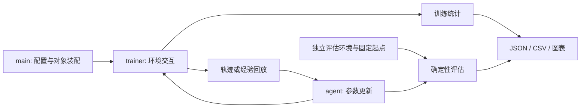

# 开发与实验约定

## 模块边界

每章保留独立代码，方便对照算法公式；目录间仍存在工具函数重复，当前未封装成统一 RL 框架。新增功能优先沿用已有模块边界，避免将环境交互、梯度更新和绘图写入同一函数。

| 模块 | 负责 | 输出/约束 |
| --- | --- | --- |
| `main.py` | 播种、创建对象、调用训练和输出、关闭环境 | 入口负责资源生命周期 |
| `config.py` | 超参数与环境选择 | 修改配置后应保留本次运行快照 |
| `environment.py` | 环境构造、动作适配 | 说明动作范围、终止与时间限制 |
| `networks.py` / `agents.py` | 网络与优化步骤 | 描述 batch 形状、梯度边界与目标公式 |
| `trainer.py` | 采样、回放、更新频率与统计 | `terminated` 控制自举，回合边界控制采样/GAE |
| `visualization.py` | 展示已收集指标 | 不在绘图函数内训练 |
| `experiments/` | 多种子编排、确定性评估、聚合 | 结果绑定预算、配置、评估协议 |



训练回报包含探索噪声，评估回报使用确定性策略。HER 以固定目标成功率为主指标；失败种子应保留，不能只报告最佳回报。历史 `legacy_v1` 与练习工具不作为新实验入口。

## 编码与注释

- Python 使用 4 空格缩进；新增函数和变量采用 `snake_case`，类采用 `PascalCase`。保留必要的旧接口别名。
- 注释解释公式、数据形状、终止语义和取舍，避免逐行翻译代码。函数文档说明输入输出与单位。
- 将单次诊断表述为“本配置下观察到”；因果结论需要对照实验支持。已知近似要在实现旁说明。
- 推理和 TD 目标使用 `torch.no_grad()`；目标网络在开始训练前同步。优化器只负责其参数的更新。
- 入口用 `try/finally` 关闭环境；子进程失败必须使批任务非零退出，不能仅打印完成。

现有代码尚未全量格式化，也没有统一类型检查；增量修改时遵守上述约定，避免为统一外观而改动历史实验实现。

## 验证

从仓库根目录、在已安装 `requirements.txt` 的虚拟环境中运行：

```bash
python -m unittest discover -s tests -v
```

测试覆盖表格训练入口、SARSA 动作连续性、DQN 参数更新与目标网络梯度隔离、DQN 回合数量和截断掩码，以及批任务错误传播。它们检查实现契约，不用随机训练的最终回报作为通过条件。

五算法短训练验证见根 README。完整训练会消耗更多资源，不作为每次文档修改的检查；结果输出应写入新目录，避免覆盖仓库保留的数据。MuJoCo 实验额外安装 `gymnasium[mujoco]`。

## 批任务

六个 Bash 入口共享 `experiments/_runner.sh`，要求 Bash 4+（Windows 可用 Git Bash）。先激活虚拟环境，或使用 `PY=/path/to/python`。`JOBS` 必须为正整数；默认值见各入口，资源较少时使用 `JOBS=1`。

```bash
PY=python JOBS=1 SEEDS="0" bash experiments/seed_experiments/halfcheetah_sac/run_all.sh
DRY=1 PY=python JOBS=1 SEEDS="0" TIERS="1" bash experiments/ablations/sac_hparams/run_sensitivity.sh
```

共享控制器逐个检查子进程退出状态；任一失败，入口返回非零，诊断输出见各实验 `results/logs/`。部分历史脚本仍按文件存在跳过结果，复用前需核对协议；改变预算或配置时使用新输出位置或备份后重跑。不要把“已跳过”当作本次验证成功。
